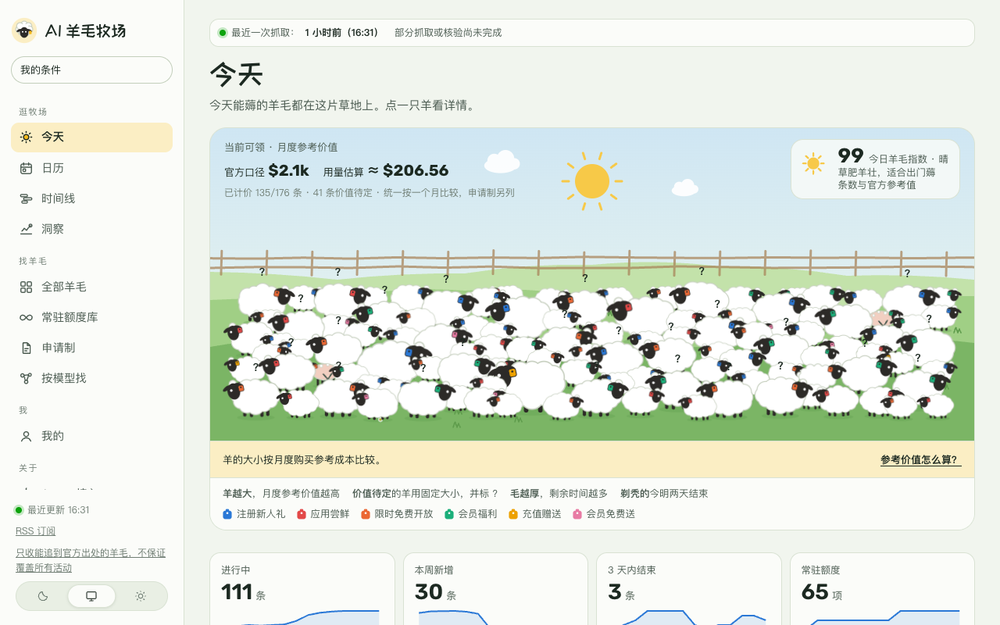

<p align="center">
  
</p>

<h1 align="center">AI 羊毛牧场</h1>

<p align="center">
  把散落各处的 AI 免费额度、赠送和限时福利收进一片草地。<br>
  每条都追到发放方的官方出处，附原文、截止时间和领取条件。
</p>

<p align="center">
  <a href="https://ai-yangmao.com">打开网站</a> ·
  <a href="https://ai-yangmao.com/#agent">让 Agent 接入</a> ·
  <a href="https://ai-yangmao.com/rss.xml">RSS</a> ·
  <a href="docs/README.md">文档</a>
</p>

<picture>
  <source media="(prefers-color-scheme: dark)" srcset="docs/assets/screenshot-dark.png">
  
</picture>

## 这是什么

模型厂商、云平台和 AI 工具经常发放免费额度：注册赠送、限时免费、会员加赠、申请制 credits……消息散在官网、文档、公众号、X、Discord 和社区帖子里，真假难辨，截止时间也常常没人写清楚。

AI 羊毛牧场每天自动收集这些线索，核实到官方出处后再上架：

- **只收能追到官方出处的羊毛。** 社区和媒体只当线索，证据必须来自发放方自己的官网、文档、公众号或账号；每条都保留官方原文摘录。
- **截止时间说清楚。** 领取截止和额度有效期分开写，按官方时区换算成你的时间；官方没写截止的，就标“截止未知”，不替官方猜。
- **价值可比较。** 统一按一个月的参考购买成本计价，写明计算方法；算不出来的标“价值待定”，不按零计算。
- **按你的条件筛。** 有没有海外手机号、信用卡、学生身份、某个会员……设好条件，只看你确定能领的。

## 网站上有什么

| 页面 | 内容 |
|---|---|
| 今天 | 羊群主视觉（每只羊一条羊毛：体型 = 价值，耳标颜色 = 类型，羊毛越薄越快结束）、倒计时、类型与模态分布 |
| 日历 / 时间线 | 每天有效的羊毛、新增与结束；按平台排开的甘特图 |
| 全部羊毛 | 按类型、模态、门槛、领取方式、平台、状态、估值方法筛选；最多三条放在一起对比 |
| 常驻额度库 / 申请制 / 按模型找 | 长期免费额度、需要申请的 credits、同一个模型在哪些平台能免费用 |
| 洞察 | 价值 × 门槛四象限、谁最大方、额度重置时钟、已结束羊毛的“墓地” |
| 详情页 | 官方原文、领取步骤、资格匹配、薅度雷达、状态时间轴、访客的“牧场心得” |

支持深色和浅色外观，手机优先。条件和“想领 / 已领”清单只保存在你自己的浏览器里，不需要账号。

## 给 Agent 用

不需要 Key，公开只读：

- **MCP**：在支持远程 MCP 的客户端里添加 `https://ai-yangmao.com/api/mcp`（Streamable HTTP），可查询最新日报、按条件筛选权益、读取领取详情和会员套餐目录。
- **Skill**：把 [`SKILL.md`](https://ai-yangmao.com/ai-yangmao-public/SKILL.md) 交给你的 agent，或者照[网站上的说明](https://ai-yangmao.com/#agent)用终端安装。
- **HTTP**：`GET /api/agent` 返回能力说明；日报、搜索和详情接口都支持 `format=markdown`。

## 它是怎么运作的

```
 官网 / 文档 / RSS / 公众号 / X / Discord 公告 / AIHOT / 社区
                         │  每小时快速通道，每 6 小时全量采集（GitHub Actions）
                         ▼
     线索 ──► 筛查与查重 ──► 抽取字段（免费模型优先，DeepSeek 兜底）
                         │
                         ▼
          官方出处核实 ──► 身份去重 ──► 人工审核 ──► 上架
                                                      │
                     网站 · RSS · 飞书日报 · Telegram · MCP / Skill
```

- **采集**（`pipeline/`）：Node.js 脚本跑在 GitHub Actions 上，由 Worker 定时触发；Reddit、LINUX DO 等会拦截云服务器 IP 的信源，由一台常开的机器中继。
- **抽取与核实**：模型只负责把原文整理成结构化字段，金额由规则计算；每次调用都经过预算台账，按日、按月封顶。
- **去重**：同一次发放在不同渠道被转述多次，靠“身份”系统合并成一条活动，避免重复上架和重复推送。
- **审核**：新平台准入和条目批准分开管理；管理员可以把亲自核实过的权益“快速上架”，其余字段由模型补齐。
- **服务**（`src/worker/`）：Cloudflare Worker + D1，提供网站、公开 API、管理后台和推送。

## 本地开发

需要 Node.js 24。

```bash
npm ci
npm run dev        # 构建前端并启动本地 Worker（wrangler dev）
npm run typecheck
npm test
```

| 目录 | 内容 |
|---|---|
| `src/worker/` | Worker：公开 API、管理后台接口、身份去重、推送 |
| `src/shared/` | 前后端共用的字段合同、检查规则、估值 |
| `pipeline/` | 采集、筛查、抽取、官方核实 |
| `web/` | 静态前端源码（构建到 `public/`） |
| `migrations/` | D1 数据库迁移 |
| `integrations/agent/` | 公开 Agent Skill 与安装脚本 |
| `docs/` | 设计、数据合同、运维说明 |

部署自己的一份需要 Cloudflare 账号（Workers + D1）和若干密钥（管理员 / 采集令牌、模型 API Key、可选的飞书和 GitHub 触发令牌）。命令、调度和发布流程见[运维说明](docs/operations.md)，字段口径见[数据合同](docs/data-contract.md)，整体设计见[设计文档](docs/design.md)。

## 说明

网站只收录能追到官方出处的活动，但**不保证覆盖所有活动**，也不保证活动一直有效；领取前请以官方页面为准。参考价值是按公开价格估算的购买成本，不代表现金或实际节省的费用。

## 许可

代码以 [MIT 许可证](LICENSE) 开源。网站收录的官方原文摘录、活动名称和商标归各发放方所有。

## 反馈

发现漏收的羊毛、过期或写错的条目，或者有改进建议，欢迎写信到 [accesaver@gmail.com](mailto:accesaver@gmail.com)，也可以直接在 GitHub 提 Issue。

## 致谢

感谢 [AIHOT](https://github.com/KKKKhazix/AIHOT)（[aihot.news](https://aihot.news)）带来的灵感：一个自己找热点、自己写日报的网站，让我们相信 AI 羊毛也可以这样被持续地收集、筛选和整理。AIHOT 的公开动态也是本站的线索来源之一。
