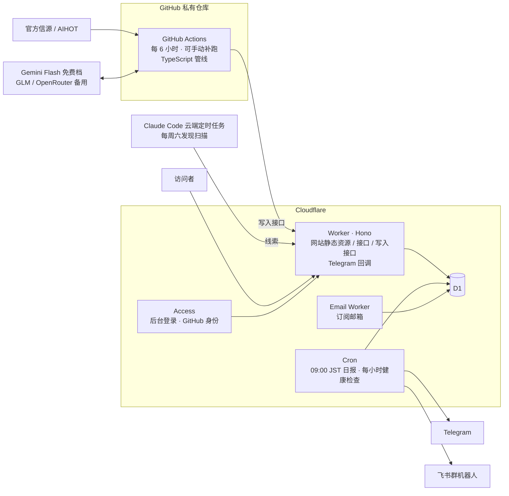

# AI 羊毛牧场 · 设计文档

> 版本 v0.2 · 2026-09-30 · 状态：设计已确认，原型 v1 已完成
> 本文是 2026-09-29 至 09-30 逐轮讨论的定稿，并吸收了一份 Codex 方案中的可取部分（见 §15 决策记录）。

## 1. 定位

一个**持续核验的 AI 羊毛库**：汇总全球可以免费薅的 AI 额度和权益，配每日变化简报。

- 只收"能薅的"。模型发布、功能更新、一般行业新闻、普通打折一律不收。
- 先给 10 人以内小范围使用，之后公开给更多人。
- 尽量零成本；唯一固定开销是域名（约 ¥75/年）。

## 2. 收录范围

| 收 | 说明 |
|---|---|
| API token / 免费额度 | 模型厂商、云厂商、推理平台的赠送额度和免费层 |
| AI 编程工具额度 | Gemini CLI、Qwen Code 每日免费次数，Cursor / Kiro 试用，Codex / Claude Code 额度重置 |
| C 端会员赠送 | 会员限时免费、学生免费一年等 |
| 申请制 credits | AWS Activate、Google for Startups、各厂商创业计划等，单独成类，只收官方长期计划 |
| 多模态生成积分 | 图像、视频、音乐、语音生成的免费积分和限免 |

**不收**：GPU / 算力平台额度、免费工具目录、没有额外权益的普通折扣。

## 3. 平台准入

**收**：
1. 模型厂商（OpenAI、Anthropic、Google、DeepSeek、Kimi、智谱、MiniMax 等）
2. 云厂商（阿里云百炼、火山方舟、腾讯云、百度千帆、AWS、Azure、GCP）
3. 有公开公司主体、自营或正规接入推理的平台（OpenRouter、OpenCode Zen、Vercel AI Gateway、Cloudflare Workers AI、GitHub Models、Hugging Face、Groq、Cerebras、Together、Fireworks、硅基流动等）
4. 知名 AI 工具本身（Cursor、Kiro、Trae、可灵、即梦、Suno 等）
5. 新玩家（新实验室、新产品，如 Jev），经人工准入后收录

**不收**：基于 one-api / new-api 搭的分销中转站、号池、拼车或共享账号、按官方价打折倒卖的站、镜像站。

平台维护在一张显式白名单里。**新平台第一次出现，一律由管理员人工准入。**

## 4. 信源与证据

### 4.1 信源分级
| 级别 | 例子 | 能否作为正式证据 |
|---|---|---|
| 官网公告 / 帮助文档 | 定价页、公告页、活动页、文档 | 能 |
| 官方账号 | 厂商官方 X、官方公众号 | 能 |
| 员工账号 | 白名单内的在职员工 X 账号（如宣布 Codex 重置的员工） | 能，但永不自动上架 |
| 线索 | AIHOT、媒体报道、社区帖、订阅邮件、周六扫描结果 | 不能，必须追到官方出处 |

员工账号进白名单需有依据：被官方账号转发过，或能在官网团队页查到。

### 4.2 证据规则
- 正式上架必须能追到官方出处，并保存**支持关键条款的原文摘录**、链接和抓取时间。
- "截止未知"的活动必须有一个**当前还能打开的权益页或领取页**作证据；旧公告仍能打开，不能单独证明仍有效。
- 模型判断不能替代官方证据。
- 资格没写清楚的标"资格未明确"，不写成人人可领。

### 4.3 渠道覆盖
| 渠道 | 方式 | 备注 |
|---|---|---|
| 官网 / 文档 / 博客 | 直接抓取（RSS、网页列表、JSON） | 主力 |
| X | AIHOT 公开接口（含 `/api/v1/codex-resets`）+ 各平台官网同步公告 | 免费方案；AIHOT 没覆盖的账号靠周六扫描补 |
| 公众号 | 官网公告页 + 补录 + 周六扫描 | 免费方案 |
| 订阅邮件 | 专用邮箱订阅厂商 newsletter，Cloudflare 邮件转发 → Email Worker 解析 | 零成本 |
| 补录 | 后台粘贴链接，或把链接转发给 Telegram 机器人 | 补公众号和 X 的缺口 |
| Hacker News | 官方免费搜索接口（Algolia），每 6 小时，关键词粗筛 | 只作线索 |
| Reddit | 已停用（2026-09-30）：Reddit 封锁云服务器和 Jina 的访问，自助创建 API 应用也被关闭，需按 Responsible Builder Policy 申请。代码已支持官方 API，获批后配置 REDDIT_CLIENT_ID / SECRET 即可启用。期间靠 AIHOT 和周六扫描覆盖 | 只作线索 |
| Discord | 自建服务器，关注厂商官方服务器的公告频道，由机器人读取；首批 4～6 家多模态厂商（Midjourney、Suno、Pika、Luma 等） | 属于官方账号级别；后续阶段做；不抓取他人服务器 |
| 发现扫描 | 每周六一次（Claude Code 云端定时任务），线索源：X、HN、Product Hunt、Reddit、V2EX、LINUX DO、AIHOT 日报 | 结果全部进待审 |

**付费方案的开启条件**：每条羊毛记录"最早出现渠道"。某条最早由我们没覆盖的 X 账号或公众号发布、而我们晚了 1 天以上才抓到，记一次漏报。**一个月累计 3 次以上**，才对缺口账号开启 SocialData（X）或极致了（公众号，约 ¥0.14/次列表查询），并设月预算上限。

AIHOT 数据的使用边界：只作线索，页面引用官方原文。其条款允许个人、公益非商业和组织内部免费使用；若以后商业化，需先向其申请书面授权。

## 5. 数据模型

### 5.1 羊毛（offers）
| 字段 | 取值 / 说明 |
|---|---|
| 平台 | 关联平台白名单 |
| 类型 | 注册新人礼 / 限时免费开放 / 会员福利（重置、加赠）/ 充值赠送 / 会员免费送 / 常驻免费额度 / 申请制 |
| 模态（多选） | 文本 / 编程 / 图像 / 视频 / 音乐·语音 |
| 领取方式 | 自动到账 / 注册即送 / 下载 App / 邮件或表单申请 / 充值触发 / 会员自动生效 / 兑换码 |
| 门槛（多选） | 零门槛 / 需充值（金额）/ 需会员（档位）/ 需海外手机号 / 需海外信用卡 / 需海外网络 / 需实名 / 需企业认证 / 需学生认证 / 需邀请码 / 定向发放 |
| 适用对象 | 新用户 / 老用户 / 全部 / 资格未明确 |
| 额度 | 官方原文（如"500 万 tokens""每天 1000 次"）+ 折合美元（估算，可空） |
| 领取时间 | 领取开始、领取截止（或"截止未知""常驻"） |
| 额度有效期 | 领取后多久失效（如"领取后 90 天""当月有效"），与领取截止分开 |
| 原始时区 | 官方原文的时区；页面按访问者本地时区换算显示 |
| 时间戳 | 官方发布时间、系统发现时间、最近核验时间、最近核验结果 |
| 状态 | 待审 / 未开始 / 进行中 / 即将结束 / 已结束 / 常驻 / 待核验 / 已拒绝 |
| 证据 | 官方链接、信源级别、原文摘录、抓取时间 |
| 领取步骤 | 有序步骤 |
| 最早出现渠道 | 用于漏报统计 |

### 5.2 其他表
- **platforms**：名称、类型（模型厂商 / 云厂商 / 推理平台 / AI 工具 / 新玩家）、准入状态、官网、官方 X 账号、员工账号、公众号
- **sources**：所属平台、类型（rss / web_list / json / aihot / email / manual / sweep）、URL、信源级别、启停、是否允许自动上架、连续原样通过计数、最近成功时间、连续失败次数
- **snapshots**：来源内容哈希与精简正文，用于变化比对
- **leads**：线索（来源渠道、原始链接、处理状态、关联羊毛）
- **offer_revisions**：条款修订记录（字段前后对比 + 证据快照）
- **reviews**：审核记录（通过 / 拒绝 / 修改了哪些字段）
- **notifications**：通知台账，唯一键为（羊毛, 阶段, 渠道），阶段 = 新增 / 变化 / 临期 / 结束 / 加急
- **runs**：每次采集的运行记录、token 用量、费用

## 6. 状态与时效规则

- **限时活动**：每 24 小时复核一次（基于内容比对，几乎不花 token）。
  - 开始时间在未来 → 未开始；距截止 ≤ 3 天 → 即将结束；过截止或官方撤回 → 已结束，立即退出可领列表。
- **截止未知**：按限时活动处理，每 24 小时复核，权益页必须仍然有效。
- **常驻额度**：记录首次发布时间和最近核验时间，每 7 天比对一次官方页面；**14 天内没有一次核验成功** → 待核验，默认视图不显示。
- **抓取失败不判定结束**：限时活动连续 48 小时核验不成功 → 待核验；恢复后重新确认。
- 已结束和已拒绝的记录保留在库里，用于纠错、通知去重和"羊毛墓地"。

## 7. 采集管线

```
每 6 小时（GitHub Actions，可手动触发 / 补跑）
  抓取到期的信源 → 去噪 → 哈希比对 ──无变化──► 结束（不花 token）
                               │ 有变化
                               ▼
                        关键词粗筛（免费/赠送/额度/重置/credits/free tier/reset…）
                               │ 命中
                               ▼
                        LLM 结构化抽取（固定 JSON 结构）→ 字段校验
                               ▼
                        与已有羊毛去重合并 → 证据门槛 → 待审 或 自动上架
                               ▼
                        重算状态 → 写通知台账 → 加急推送（审核通过后才发）
```

- **省 token**：先比对再调模型；模型只做抽取，不做搜索；查询、日期判断、去重、日报编排全部由程序完成。
- **模型**：主用 Gemini Flash 免费档；GLM Flash 和 OpenRouter 免费模型做备用。每天 token 上限 20 万；每月费用上限 ¥10（正常应为 ¥0，只在切到付费备用模型时起作用）。超限后只跑规则采集，复杂内容进待核验。
- **写库**：管线调用网站的写入接口（仅限本站的密钥），数据校验只在一处实现。
- **语言**：TypeScript，与网站共用字段定义和校验规则。

## 8. 审核与自动上架

- **起步**：全部进待审。
- **放权单位**：平台 × 信源。某个信源连续 **5 条**被原样通过（未改字段），系统在 Telegram 提议放开，管理员确认后生效；任何一次拒绝或修改都把计数清零。
- **自动上架的硬门槛**：权益、资格、领取方式、有效期四项都有官方原文摘录支撑，缺一项就进待审。
- **永不自动上架**：新平台首次出现、员工账号来源、由社区线索追查而来的。

## 9. 推送

| | Telegram（管理员） | 飞书群（其他人） |
|---|---|---|
| 日报 | 每天东京时间 09:00（北京 08:00） | 同 |
| 日报内容 | 新增、权益或条件变化、3 天内临期、已结束；外加待审条目 | 只含已上架内容 |
| 加急 | 距截止 ≤ 48 小时的新羊毛，审核通过后立即推送 | 同 |
| 空日报 | 不发 | 不发 |
| 告警 | 连续 8 小时无成功采集；信源连续失败；恢复后自动解除 | — |
| 交互 | 通过 Hermes Agent 对话："看待审""通过 a3f9""拒绝 kesd 理由""今天有什么羊毛""10 月 5 日能薅什么"，转发链接即补录 | 只读 |

- 同一羊毛同一阶段在每个渠道只发一次；加急发过的，日报不原样重复。
- 两个渠道各自记录发送结果，互不阻塞；结果不明的请求不盲目重发。

## 10. 网站

公开可看，初期设 `noindex`；中文界面，保留原始品牌和权益名称；提供 RSS；页头显示"最近成功更新时间"。全站使用 ECharts，手机优先；所有卡片、图表元素、列表项都能点进详情。

| 页面 | 内容与可视化 |
|---|---|
| 今天 | 羊群主视觉（每只羊一条羊毛：体型 = 价值，耳标颜色 = 类型，羊毛厚度 = 剩余时间，快到期的被剃秃）、今日可薅总价值、羊毛天气预报、关键数字 + 迷你趋势线、倒计时时钟、类型环形图、模态分布、即将开始、卡片墙（迷你雷达 + 剩余时间条） |
| 日历 | 月历热力图（颜色 = 当天有效条数或总价值，草色越深越多）、新增与结束打点、节日叠加；点任意一天列出当天有效的羊毛 |
| 时间线 | 甘特图：每个平台一行，颜色区分类型，"今天"竖线，快结束的高亮 |
| 全部 | 按类型、模态、门槛、领取方式、平台、状态筛选；按新上架 / 快截止 / 价值高排序；对比器（最多 3 条雷达叠加） |
| 常驻额度库 | 平台 × 模态热力矩阵、每日免费价值排行、核验新鲜度 |
| 申请制 | 卡片 + 额度量级对比 |
| 按模型找 | 模型 ↔ 平台关系图 |
| 洞察 | 四象限（价值 × 门槛）、桑基图、谁最大方（矩形树图）、大方榜赛跑、重置时钟、趋势、羊毛墓地 |
| 平台页 | 平台雷达、历史时间线、发放频率 |
| 详情页 | 薅度雷达、倒计时、领取截止与额度有效期分开显示、原始时区、适用资格与"我的条件"匹配、领取步骤、官方证据与最近核验结果、条款修订记录、状态时间轴 |
| 我的 | 我的条件（全站只看我能薅的）、想领 / 已领清单、本月已薅进度环；首版只存在浏览器本地，不设用户账号（换设备不同步）；以后公开时再考虑同步码或正式账号 |
| 覆盖范围 | 已监控的平台和信源、已知缺口、"不保证覆盖所有活动"声明 |
| 后台 | 待审队列、补录、平台白名单、信源健康（心电图）、自动上架开关、放权进度曲线、审核漏斗、付费接口与模型预算用量 |

**薅度雷达**（全部按规则计算，不调用模型）：价值（折合美元分档）、门槛、领取难度、剩余时间、信源可信度、国内能否直接领取；六项加权合成"薅度分"用于排序。

**视觉方向**：清新田园为底（草绿、天空蓝调的中性色，羊耳标黄做点缀，耳标形状的类型标签，图表干净精确），手绘绘本插画只用于首页羊群、空白页和少数图标；动效集中在羊被剃毛和倒计时，开启"减少动态效果"时关闭。

## 11. 技术架构



| 层 | 选择 |
|---|---|
| 网站前端 | Vite + React（SPA）+ ECharts |
| 网站后端 | Cloudflare Workers + Hono（同一个 Worker 负责静态资源、接口、Telegram 回调、定时推送和收邮件） |
| 数据库 | Cloudflare D1 + Drizzle |
| 后台登录 | Cloudflare Access（50 人内免费，用 GitHub 登录） |
| 采集 | GitHub Actions + TypeScript（Node 22+） |
| 发现扫描 | Claude Code 云端定时任务，每周六 |
| 域名 | Cloudflare Registrar，.com 约 $10.5/年，续费同价 |

## 12. 成本

| 项 | 费用 |
|---|---|
| 域名 | ai-yangmao.com，$10.46/年（Cloudflare Registrar，2026-09-30 购入） |
| Cloudflare（Workers、D1、Cron、Access、邮件转发） | 免费档 |
| GitHub Actions | 私有仓库每月 2000 分钟免费额度内 |
| 模型 | 免费档为主，月上限 ¥10 |
| SocialData / 极致了 | 未开启；按 §4.3 的漏报规则决定 |

## 13. 验收场景（上线前的测试清单）

1. 普通模型新闻、不明中转站、已结束活动不会进入当前可领列表。
2. 常驻免费、充值赠送、会员重置、特殊资格活动分类正确。
3. 领取截止与额度失效不混淆；日期查询正确处理时区和"当天截止"。
4. 来源打不开时显示待核验，不误报结束；恢复后能重新确认。
5. 重复采集、任务补跑、单渠道发送失败都不会造成重复推送。
6. 模型预算耗尽后，基本采集、查询和通知照常运行。
7. 手机上能完整完成筛选、查看证据、打开官方领取入口。

## 14. 实施阶段

1. **原型**（v1 已完成：`prototype/`）：单文件网页 + 示例数据，所有页面和图表可点，定视觉。
2. **数据底座**（已完成 2026-09-30）：D1 表结构（`src/db/schema.ts`）、时间与状态规则及测试（`src/shared/lifecycle.ts`）、Hono 接口与写入接口（`src/worker/index.ts`）、种子白名单 65 个平台（`seed/platforms.json`，待管理员审核）。原型已部署到 https://ai-yangmao.com（noindex）。
3. **管线 v1**（已上线 2026-09-30，等模型 key 开启抽取）：`pipeline/`，GitHub Actions 每 6 小时运行，可手动补跑。线索：AIHOT（含 Codex 重置）、HN、Reddit（云端 IP 会被 Reddit 限流，需配置免费的 Reddit 应用走官方 API）。17 个官方页面 / RSS：只保留羊毛相关句子后比对哈希，有变化才抽取；正文抽取参考 AIHOT（Readability 与整页纯文本择优，不足时用 Jina Reader）；模型给出的摘录必须能在原文逐字找到。
4. **推送**（2026-09-30 调整为 Hermes 方案）：Telegram 复用用户已有的 Hermes Agent 机器人——技能 `integrations/hermes/ai-yangmao/SKILL.md` 通过命令行 `scripts/ym.ts` 调用管理接口（`/api/admin/*`，ADMIN_TOKEN），用户用自然语言+4 位短码审核、编辑、补录、查询；Hermes 定时任务（无模型、脚本输出直接投递）每天 09:00 发日报、每小时检查加急与采集故障，没有内容就不发。通知台账按（羊毛, 阶段, 渠道）去重。飞书群日报由云端 Worker 定时发送（待提供 webhook）。依赖：常开 Mac 上的 Hermes 网关在运行。
5. **网站 v1**：按原型实现，接真实数据。
6. **补全**：订阅邮箱、HN 与 Reddit 线索源、周六发现扫描、覆盖范围页、健康告警。
7. **Discord**：自建服务器关注厂商公告频道 + 读取机器人。
8. 跑两周校准审核规则，逐步放开自动上架。

**需要准备的账号与密钥**（第 2 阶段起）：Cloudflare 账号与域名、Telegram 机器人 token（BotFather）、飞书群自定义机器人 webhook、Gemini / GLM / OpenRouter API key、GitHub 私有仓库。

## 15. 决策记录

| 日期 | 决定 | 理由 |
|---|---|---|
| 09-29 | 形态：网页 + Telegram（管理员）+ 飞书群（其他人） | 网页便于以后推给不用飞书的人 |
| 09-29 | 范围含多模态生成、申请制单列，不含算力 | 多模态也属大模型，关键词和流程相同 |
| 09-29 | 官方 + 白名单员工账号；社区只当线索 | 重置类常只出现在员工推文 |
| 09-29 | 半自动审核，逐个信源放权 | 起步阶段重点校准 |
| 09-29 | 公众号和 X 先走免费方案，漏报多了再付费 | 先用数据证明缺口 |
| 09-29 | Cloudflare 而非 Vercel + Neon | 免费档可商用、Cron 准点、单平台维护、Access 免写登录、域名成本价 |
| 09-30 | 名称"AI 羊毛牧场" | 品牌记忆点，与"薅度雷达"不重名 |
| 09-30 | 每 6 小时采集；不发空日报，改用 8 小时无成功采集告警 | 用户选择 |
| 09-30 | 前端 Hono + Vite + React；管线 TypeScript | 页面以图表为主、初期不需服务端渲染；单一语言 |
| 09-30 | 吸收 Codex 方案：领取截止与额度有效期分离、原始时区、修订记录、新标签、24 小时复核、证据硬门槛、通知台账、渠道独立、补录、覆盖范围页、预算降级、验收场景 | 提升数据可信度与运行可靠性 |
| 09-30 | 不采纳 Codex：收录算力、取消历史日期查询、极简三入口、自写 OAuth、直连 D1 写库 | 与已定需求冲突，或有更省事的做法 |
| 09-30 | 视觉：清新田园为底 + 局部绘本插画 | 好看耐看，数据清楚，保留牧场感 |
| 09-30 | 后台正式版由 Cloudflare Access 保护，访客导航不显示入口；原型保留入口用于演示 | 用户选择 |
| 09-30 | HN（Algolia 接口）与 Reddit（RSS）作为每 6 小时线索源；Discord 用"关注公告频道"方式，后续阶段做 | 零成本、合规 |
| 09-30 | 域名 ai-yangmao.com（Cloudflare Registrar，$10.46/年） | 成本价，续费同价 |
| 09-30 | 首版不设用户账号，想领/已领只存本机 | 资讯产品看羊毛不该要求登录；10 人规模登录是门槛 |
