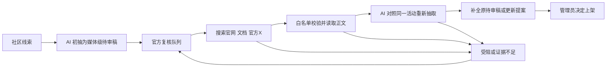

# 社区线索自动官方复核

这是采集工作流的固定阶段，在 GitHub Actions 的每小时快速采集和全量采集中自动执行，不依赖聊天里的人工搜索。



## 执行规则

- 目标为已准入平台的媒体级待审条目、媒体级更新提案；现有积压也自动进入队列。未准入平台仍需先准入。
- 每轮默认最多8条（`OFFICIAL_REVIEW_LIMIT`），每条最多2次搜索、3个官方候选页面、4分钟；沿用现有模型预算和供应商兜底。任务临近截止会收尾，不拖死原采集。
- 搜索使用 Exa 官方远程 MCP HTTP 接口，可直接从 Actions 调用；不需要本机浏览器、Cookie、mcporter 或聊天工具。搜索服务限流时记录失败并重试，不把失败当成不存在。默认使用无需密钥的接口；可配置仓库 secret `EXA_API_KEY` 使用专用额度，搜索费用由该账户控制，与模型月预算分开。当前未配置该密钥。
- 官方身份以平台与已登记官方信源为准。X严格匹配已登记账号的帖子；共享托管站按仓库/路径限定，不信任整站任意用户内容。
- 搜索摘要、模型猜的链接只能发现候选，不能直接作为证据。必须重新抓取正文；Jina回退还需匹配来源元信息且没有错误警告。旧普通采集中的间接抓取仍保持媒体级。
- AI只对照同一活动抽取，官方事实优先于社区说法；无法唯一匹配、缺权益原文或字段校验失败则保持原稿。复用通用规则、平台要点和管理员纠正。
- 原始社区URL、搜索词、候选URL、采用URL、修改字段、失败原因、尝试次数及下次重试时间存为内部 `official_review` 记录，公开接口不输出。
- 搜索任务带占位和版本校验；管理员在此期间修改条目时，旧任务不能覆盖其操作。人工锁定字段继续保护。
- 自动补全始终保持待审；已上架版本保持原样，变更只进入提案。此阶段不能自动通过，也不能自行标 tested。
- 默认按1、2、4、8小时等退避，最多5次后等人工处理；管理员可点“重新排入官方复核”。条目出现新的内容修改时可重新排队。
- 官方原文匹配完成后，审核提醒会产生新的对象版本；不会因为之前提醒过媒体稿而漏掉补全结果。

## 代码入口与验收

- `pipeline/run.ts`：正常流程在初抽后、全站复核前调用 `runOfficialReviews`。
- `pipeline/official-review.ts`：云端搜索、正文抓取、AI二次抽取和结果回写。
- `src/worker/official-review.ts`：队列、任务占位、结果确认与重试状态。
- `migrations/0012_official_review.sql`：新增内部记录列；旧数据不自动批准。
- 后台条目中的“官方复核”折叠区展示进展，`ym health` 展示统计。
- 验证包含真实入口的自动调用、匹配成功、搜索限流、无匹配不改稿、假官方账号/共享域名拦截、任务并发占位、管理员修改竞争、已上架提案隔离及内部记录不公开。

手动补跑仍由同一个工作流执行：

```bash
gh workflow run collect.yml --ref main -f fast_leads=true -f official_review_limit=2
```

`official_review_limit=0` 只用于明确跳过该阶段的诊断任务。正常定时调用不传此参数，默认启用。


## 首次线上验证（2026-10-08）

0012迁移已应用，迁移前保留了本地受保护备份。首个真实云端采集任务37865844431自动处理两条：Max API赠额检索到了platform.claude.com官方文档，AI修改字段并保持pending；Windsurf旧折扣未得到可应用匹配，保留原稿并排入退避重试。不是聊天手工提供官方URL，也没有自动批准。Max的补充X检索受限，但主检索返回的官方文档成功使用。修复了最后一条已完成时仍错误增加延期计数的收尾问题，补了对应回归。

最终功能提交29484ed，Worker版本af5f398f-9f32-440f-ad10-d4782b6e8b26。180项本地回归、类型检查和构建通过；CI 37866544656成功；修正后的真实云端采集37866544943成功，自动执行2次搜索处理1条复核，无可用匹配时保留待审并安排重试。正常每小时任务默认启用8条，不需要聊天介入。线上app.js与测试构建一致。
